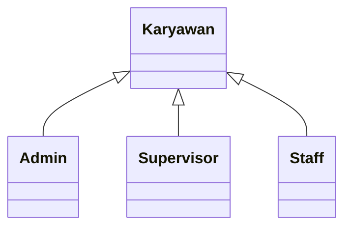

# ⏱️ CrunchShift
## Sistem Manajemen Aktivitas, Absensi, dan Apresiasi Karyawan Berbasis Shift dengan Reward Points

## **SDGs:** Decent Work and Economic Growth (SDG 8)
## **Fokus Area:** Structured Shift Coordination, Transparent Attendance, and Fair Employee Appreciation


---

### 👥 Anggota Kelompok 11:
1. Muhammad Attar Khanza Habibillah (2509116006)
2. Evan Setiawan (2509116036)
3. Az-Zahra Imsawati Sugianto (2509116062)
4. Arizky Saputra (2509116088)

---

## 💡 Deskripsi Singkat Program

Aplikasi **“CrunchShift”** merupakan sistem informasi *desktop* berbasis **Java** yang dikembangkan untuk mengintegrasikan pengelolaan jadwal kerja *shift*, pencatatan presensi *real-time*, dokumentasi log aktivitas serah terima pekerjaan, serta pemberian apresiasi karyawan pada operasional industri *Fast-Moving Consumer Goods* (FMCG) **PT Crunch**. Program ini dibangun dengan menerapkan **lima pilar utama Pemrograman Berorientasi Objek (*Object-Oriented Programming* / OOP)**, yaitu **Encapsulation**, **Inheritance**, **Abstraction**, **Polymorphism**, dan **Interface**, menggunakan arsitektur **Pure MVC + DAO** yang terhubung langsung ke basis data **MySQL (`crunchshift_db`)** serta antarmuka grafis (**GUI**) berbasis **Java Swing** pada **Apache NetBeans IDE**.

Proyek ini dirancang untuk mendukung pencapaian **Tujuan Pembangunan Berkelanjutan (SDGs) poin ke-8**, yakni *Decent Work and Economic Growth* (Pekerjaan Layak dan Pertumbuhan Ekonomi). Pada lingkungan produksi berbasis giliran kerja, kendala komunikasi saat pergantian operator dan pencatatan kehadiran manual kerap memicu keterlambatan maupun penilaian kinerja yang kurang objektif. Melalui **CrunchShift**, seluruh aktivitas operasional lintas departemen (*Administrasi*, *Produksi*, dan *Logistik*) dikelola secara transparan, akuntabel, dan terdokumentasi dengan baik.

Sistem ini membagi hak akses ke dalam empat antarmuka peran spesifik, yaitu **Admin Pusat**, **Admin Cabang**, **Supervisor**, dan **Staff**. Dilengkapi fitur unggulan seperti mesin presensi digital zona waktu **WITA (`Asia/Makassar`)**, validasi keaslian foto bukti kehadiran berbasis *hashing* **SHA-256 (*Anti-Fraud*)**, serta mekanisme penghargaan **CrunchPoints**, aplikasi ini mendorong terciptanya lingkungan kerja yang terorganisasi, produktif, dan menghargai kontribusi setiap karyawan secara adil.

---

## 🧩 Fitur Utama Program

- **Autentikasi Multi-Peran & Manajemen Sesi (*Role-Based Access Control*)**  
  Setiap pengguna masuk menggunakan kredensial terdaftar pada tabel karyawan. Sistem memvalidasi status keaktifan akun, menginisialisasi `SessionManager`, dan mengarahkan pengguna ke antarmuka sesuai perannya (*Admin Pusat*, *Admin Cabang*, *Supervisor*, atau *Staff*) dengan pola navigasi *Dashboard-First* berbasis `CardLayout`.

- **Manajemen Master Karyawan, Shift, & Kategori Poin (Admin Pusat)**  
  Admin Pusat mengelola data induk karyawan lintas cabang dan departemen, mengatur jam operasional master *shift*, menetapkan kategori serta batas maksimal *CrunchPoints*, dan memantau rekapitulasi presensi tingkat nasional.

- **Penjadwalan *Shift* Anti-Bentrokan & Operasional Unit (Admin Cabang)**  
  Admin Cabang mendaftarkan akun *Supervisor* dan *Staff* di unit kerjanya serta menyusun jadwal *shift* harian dengan fitur deteksi konflik otomatis agar tidak terjadi penjadwalan ganda (*double-booking*) pada karyawan dan tanggal yang sama.

- **Mesin Presensi Digital *Real-Time* WITA & Deteksi *Anti-Fraud* SHA-256 (Staff)**  
  Menyediakan pencatatan *Check-In* dan *Check-Out* menggunakan jam digital *real-time* zona waktu `Asia/Makassar` yang otomatis menentukan status kehadiran (*Hadir* atau *Terlambat*). Bukti foto yang diunggah divalidasi nilai *hash* SHA-256-nya guna mencegah penggunaan ulang foto lama (*duplicate photo fraud*).

- **Log Aktivitas Harian & Serah Terima Antar-*Shift* (Staff & Supervisor)**  
  Memfasilitasi *Staff* untuk mendokumentasikan pekerjaan, kendala produksi, dan catatan serah terima bagi giliran kerja berikutnya, yang kemudian ditinjau oleh *Supervisor* untuk disetujui (*Terverifikasi*) atau diminta perbaikan (*Revisi*).

- **Verifikasi Presensi dengan Pratinjau Foto Berdampingan (Supervisor)**  
  *Supervisor* dapat memeriksa keabsahan data presensi yang berstatus *Menunggu* melalui tampilan pratinjau foto masuk dan keluar secara berdampingan sebelum memberikan persetujuan (*Disetujui*) atau penolakan disertai alasan wajib (*Ditolak*).

- **Gamifikasi Apresiasi & Evaluasi Kinerja *CrunchPoints* (Supervisor & Staff)**  
  *Supervisor* dapat memberikan poin apresiasi kelipatan terukur ($25$, $50$, $75$, hingga $100$) yang secara transaksional menambah saldo poin *Staff*, ataupun memberikan nilai $0$ poin sebagai catatan evaluasi pembinaan tanpa mengurangi saldo poin yang telah dikumpulkan.

---

## 📊 Perancangan Sistem

### 1. Flowchart Program
> **Slot Gambar Flowchart Alur Utama, Admin, Supervisor, dan Staff:**


`Tautan Dokumen Flowchart`: [Lihat Flowchart Lengkap di Google Drive](MASUKKAN_LINK_GDRIVE_FLOWCHART_DISINI)

### 2. Use Case Diagram
> **Slot Gambar Use Case Diagram:**


`Tautan Dokumen Use Case`: [Lihat Use Case Diagram di Google Drive](MASUKKAN_LINK_GDRIVE_USECASE_DISINI)

### 3. Entity Relationship Diagram (ERD Logical & Relational)
> **Slot Gambar ERD Basis Data `crunchshift_db`:**


`Tautan Dokumen ERD`: [Lihat ERD Lengkap di Google Drive](MASUKKAN_LINK_GDRIVE_ERD_DISINI)

---

# 🧠 Analisis Penerapan 5 Pilar OOP pada Proyek `CrunchShift`

Proyek **CrunchShift** dikembangkan menggunakan bahasa pemrograman **Java** dengan menerapkan paradigma **Object-Oriented Programming (OOP)** secara murni sesuai standar arsitektur perangkat lunak. Seluruh komponen dalam *package* `com.crunchshift` telah mengimplementasikan kelima pilar utama OOP, yaitu:

> **Encapsulation**, **Inheritance**, **Abstraction**, **Polymorphism**, dan **Interface**.

Berikut penjelasan lengkap disertai potongan kode dan analisis penerapan dari setiap pilar OOP:

---

## 1. Encapsulation (Enkapsulasi)

### Konsep:
Enkapsulasi adalah prinsip OOP untuk melindungi keadaan internal objek dengan menyembunyikan atribut menggunakan *access modifier* `private` agar tidak dapat diakses atau diubah secara sembarangan dari luar kelas. Akses baca dan tulis hanya diberikan melalui metode **getter** dan **setter** yang dilengkapi validasi.

### 📁 a. `Karyawan.java` & `Staff.java` (Package: `com.crunchshift.model`)
```java
package com.crunchshift.model;

public abstract class Karyawan {
    private int idKaryawan;
    private String nama;
    private String email;
    private String password;
    private String noTelepon;
    private String peran;
    private boolean statusAktif;

    public String getEmail() { return email; }
    public void setEmail(String email) {
        if (email != null && email.contains("@")) {
            this.email = email.trim();
        }
    }

    public String getPassword() { return password; }
    public void setPassword(String password) { this.password = password; }
}
```
Atribut sensitif pengguna seperti `email`, `password`, `noTelepon`, dan `statusAktif` pada `Karyawan.java` serta `saldoPoin` pada `Staff.java` dideklarasikan sebagai `private` untuk menjaga keamanan kredensial dan mencegah manipulasi poin di luar prosedur transaksi resmi.

### 📁 b. `Absensi.java` (Package: `com.crunchshift.model`)
```java
package com.crunchshift.model;

import java.time.LocalDate;
import java.time.LocalDateTime;

public class Absensi {
    private int idAbsensi;
    private int idKaryawan;
    private int idShift;
    private LocalDate tanggal;
    private LocalDateTime waktuMasuk;
    private LocalDateTime waktuKeluar;
    private String statusKehadiran;
    private String statusVerifikasi;
    private String fotoMasuk;
    private String fotoKeluar;
    private String hashFoto;
    private String catatan;

    public String getHashFoto() { return hashFoto; }
    public void setHashFoto(String hashFoto) { this.hashFoto = hashFoto; }

    public String getStatusVerifikasi() { return statusVerifikasi; }
    public void setStatusVerifikasi(String statusVerifikasi) {
        if ("Menunggu".equals(statusVerifikasi) || 
            "Disetujui".equals(statusVerifikasi) || 
            "Ditolak".equals(statusVerifikasi)) {
            this.statusVerifikasi = statusVerifikasi;
        }
    }
}
```
Seluruh atribut presensi termasuk jejak keamanan `hashFoto` dan `statusVerifikasi` dikapsulasi secara ketat agar alur pemeriksaan *anti-fraud* dan status verifikasi tetap konsisten dengan aturan domain `crunchshift_db`.

### 📁 c. `CrunchPoints.java` & `LogAktivitas.java`
Kedua entitas operasional ini juga membungkus atribut seperti `nilaiPoin`, `jenisTransaksi` (`Apresiasi` atau `Evaluasi`), `deskripsiAktivitas`, dan `catatanSupervisor` dengan akses `private` serta metode *getter-setter* tervalidasi.

🔎 **Analisis Penerapan:** Penerapan enkapsulasi pada ke-10 kelas entitas di dalam *package* `com.crunchshift.model` menjamin tidak adanya perubahan data liar dari lapisan antarmuka (`view`). Integritas data akun, presensi, log serah terima, dan saldo poin selalu terjaga melalui jalur mutator yang sah.

---

## 2. Inheritance (Pewarisan)

### Konsep:
*Inheritance* (pewarisan) memungkinkan kelas turunan (*subclass*) mewarisi atribut dan metode umum dari kelas induk (*superclass*) menggunakan kata kunci `extends` serta konstruktor `super(...)`, sehingga meminimalkan duplikasi kode dan memperjelas struktur spesialisasi entitas.

### 📁 a. Kelas Turunan `Admin.java`
```java
package com.crunchshift.model;

public class Admin extends Karyawan {
    private int idAdmin;
    private String tingkatanAkses; // Pusat atau Cabang

    public Admin(int idKaryawan, String nama, String email, String password,
                 String noTelepon, boolean statusAktif, int idAdmin, String tingkatanAkses) {
        super(idKaryawan, nama, email, password, noTelepon, "Admin", statusAktif);
        this.idAdmin = idAdmin;
        this.tingkatanAkses = tingkatanAkses;
    }

    public String getTingkatanAkses() { return tingkatanAkses; }
    public void setTingkatanAkses(String tingkatanAkses) { this.tingkatanAkses = tingkatanAkses; }

    @Override
    public String getDeskripsiPeran() {
        return "Administrator (" + tingkatanAkses + ")";
    }
}
```
Kelas `Admin` mewarisi identitas umum dari `Karyawan` dan menambahkan atribut spesifik `tingkatanAkses` untuk membedakan kewenangan **Admin Pusat** dan **Admin Cabang**.

### 📁 b. Kelas Turunan `Supervisor.java`
```java
package com.crunchshift.model;

public class Supervisor extends Karyawan {
    private int idSupervisor;
    private String areaTanggungJawab;

    public Supervisor(int idKaryawan, String nama, String email, String password,
                      String noTelepon, boolean statusAktif, int idSupervisor, String areaTanggungJawab) {
        super(idKaryawan, nama, email, password, noTelepon, "Supervisor", statusAktif);
        this.idSupervisor = idSupervisor;
        this.areaTanggungJawab = areaTanggungJawab;
    }

    @Override
    public String getDeskripsiPeran() {
        return "Supervisor Area: " + areaTanggungJawab;
    }
}
```
Kelas `Supervisor` memperluas kelas `Karyawan` dengan atribut `areaTanggungJawab` (seperti *Lini Biskuit*) sebagai penentu cakupan pengawasan operasional.

### 📁 c. Kelas Turunan `Staff.java`
```java
package com.crunchshift.model;

public class Staff extends Karyawan {
    private int idStaff;
    private String divisi;
    private int saldoPoin;

    public Staff(int idKaryawan, String nama, String email, String password,
                 String noTelepon, boolean statusAktif, int idStaff, String divisi, int saldoPoin) {
        super(idKaryawan, nama, email, password, noTelepon, "Staff", statusAktif);
        this.idStaff = idStaff;
        this.divisi = divisi;
        this.saldoPoin = saldoPoin;
    }

    @Override
    public String getDeskripsiPeran() {
        return "Staff Divisi " + divisi + " | Saldo Poin: " + saldoPoin + " pts";
    }
}
```
Kelas `Staff` mewarisi seluruh properti `Karyawan` sekaligus menambahkan atribut `divisi` dan `saldoPoin` untuk pencatatan akumulasi *CrunchPoints*. Selain pada model domain, pewarisan juga diterapkan pada komponen `view` yang menurunkan `javax.swing.JFrame`, `AbstractTableModel`, dan `DefaultTableCellRenderer`.

### 📁 d. Struktur Hierarki Pewarisan


🔎 **Analisis Penerapan:** Hierarki *supertype-subtype* antara `Karyawan` dengan `Admin`, `Supervisor`, dan `Staff` selaras secara presisi dengan skema relasional basis data, menghilangkan penulisan ulang kode identitas pengguna, serta mempermudah manajemen sesi pada `SessionManager`.

---

## 3. Abstraction (Abstraksi)

### Konsep:
Abstraksi menyembunyikan detail teknis yang kompleks dan menetapkan kerangka dasar entitas melalui kelas abstrak (`abstract class`) serta metode abstrak (`abstract method`) yang wajib diwujudkan oleh setiap kelas turunannya.

### 📁 a. Kelas Abstrak `Karyawan.java`
```java
package com.crunchshift.model;

public abstract class Karyawan {
    private int idKaryawan;
    private String nama;
    private String email;
    private String password;
    private String noTelepon;
    private String peran;
    private boolean statusAktif;

    public Karyawan(int idKaryawan, String nama, String email, String password,
                    String noTelepon, String peran, boolean statusAktif) {
        this.idKaryawan = idKaryawan;
        this.nama = nama;
        this.email = email;
        this.password = password;
        this.noTelepon = noTelepon;
        this.peran = peran;
        this.statusAktif = statusAktif;
    }

    // Metode abstrak yang wajib diimplementasikan oleh setiap subclass peran
    public abstract String getDeskripsiPeran();
}
```
Dalam sistem **CrunchShift**, tidak ada entitas karyawan generik tanpa peran spesifik; oleh sebab itu `Karyawan` dijadikan `abstract class` sehingga tidak dapat diinstansiasi secara langsung. Metode abstrak `getDeskripsiPeran()` menetapkan kontrak informasi peran tanpa perlu mengetahui detail atribut tiap *subclass*.

### 📁 b. Abstraksi Utilitas Sistem (`FileHashUtil.java` & `DatabaseConnection.java`)
Detail kompleks kriptografi perhitungan *digest* byte berkas gambar disembunyikan di balik pemanggilan satu metode bersih `FileHashUtil.generateSHA256(file)`, sehingga kelas `StaffController` cukup berfokus pada alur validasi keunikan foto tanpa dibebani logika pembacaan *byte stream*.

🔎 **Analisis Penerapan:** Abstraksi menjaga batas tanggung jawab antarkelas tetap bersih, mencegah instansiasi objek yang tidak utuh, serta menyederhanakan interaksi antara lapisan *controller*, utilitas keamanan, dan antarmuka pengguna.

---

## 4. Polymorphism (Polimorfisme)

### Konsep:
Polimorfisme memungkinkan suatu referensi objek atau nama metode mengeksekusi perilaku yang berbeda bergantung pada tipe objek aktual saat program berjalan (*Method Overriding*) maupun variasi parameter yang dikirimkan (*Method & Constructor Overloading*).

### 🔹 A. Polymorphism — *Method Overriding* (Polimorfisme Dinamis)
Setiap kelas turunan `Karyawan` menimpa (`@Override`) metode `getDeskripsiPeran()` sesuai konteks perannya masing-masing:
```java
// Pemanggilan polimorfik melalui SessionManager pada header antarmuka
Karyawan penggunaAktif = SessionManager.getCurrentUser();
lblInfoSesi.setText(penggunaAktif.getNama() + " - " + penggunaAktif.getDeskripsiPeran());
```
Ketika pengguna yang masuk adalah instansiasi `Admin`, output yang dihasilkan menampilkan tingkatan aksesnya (`Pusat`/`Cabang`); apabila `Supervisor`, menampilkan area pengawasannya; dan apabila `Staff`, menampilkan divisi serta perolehan poinnya. Selain itu, `StatusBadgeRenderer` juga menimpa metode `getTableCellRendererComponent()` untuk mewarnai sel status tabel secara dinamis (*Disetujui*, *Menunggu*, *Terlambat*, *Ditolak*).

### 🔹 B. Polymorphism — *Method & Constructor Overloading* (Polimorfisme Statis)
Diterapkan pada lapisan DAO dan Controller melalui penyediaan beberapa metode bernama sama dengan parameter pencarian yang berbeda:
```java
package com.crunchshift.dao;

import com.crunchshift.model.Absensi;
import java.time.LocalDate;
import java.util.List;

public interface AbsensiDAO {
    // 1. Mengambil seluruh riwayat absensi milik satu karyawan
    List<Absensi> cariAbsensi(int idKaryawan);

    // 2. Overloading: Mengambil absensi spesifik karyawan pada tanggal tertentu
    Absensi cariAbsensi(int idKaryawan, LocalDate tanggal);

    // 3. Overloading: Mengambil daftar absensi lintas cabang berdasarkan rentang tanggal
    List<Absensi> cariAbsensi(LocalDate tanggalMulai, LocalDate tanggalAkhir);
}
```
Konstruktor pada kelas-kelas model juga menerapkan *constructor overloading* untuk memfasilitasi pembuatan objek baru sebelum disimpan ke basis data (tanpa `id` *auto-increment*) maupun pemetaan objek utuh hasil pembacaan `ResultSet` dari basis data.

🔎 **Analisis Penerapan:** Kombinasi *overriding* dan *overloading* membuat kode program jauh lebih ekspresif, luwes dalam menangani berbagai skenario filter data, dan mudah dikembangkan tanpa menduplikasi nama metode.

---

## 5. Interface (Antarmuka)

### Konsep:
*Interface* mendefinisikan kontrak perilaku murni berupa kumpulan tanda tangan metode (*method signatures*) yang memisahkan spesifikasi layanan akses data dari detail implementasi teknis JDBC MySQL.

### 📁 a. Kontrak DAO pada Package `com.crunchshift.dao`
Seluruh operasi persistensi basis data didefinisikan terlebih dahulu melalui *interface* dedikasi, seperti `KaryawanDAO.java`, `ShiftDAO.java`, `JadwalShiftDAO.java`, `AbsensiDAO.java`, `LogAktivitasDAO.java`, dan `CrunchPointsDAO.java`:
```java
package com.crunchshift.dao;

import com.crunchshift.model.CrunchPoints;
import java.util.List;

public interface CrunchPointsDAO {
    boolean berikanPoinApresiasi(CrunchPoints transaksiPoin);
    boolean simpanCatatanEvaluasi(CrunchPoints catatanEvaluasi);
    List<CrunchPoints> ambilRiwayatByStaff(int idStaff);
    List<CrunchPoints> ambilSemuaTransaksi();
}
```

### 📁 b. Implementasi Konkret pada Package `com.crunchshift.dao.impl`
Kelas implementasi seperti `CrunchPointsDAOImpl.java` mewujudkan seluruh kontrak metode dari `CrunchPointsDAO` menggunakan manajemen transaksi JDBC manual (`setAutoCommit(false)`, `commit()`, dan `rollback()`):
```java
package com.crunchshift.dao.impl;

import com.crunchshift.config.DatabaseConnection;
import com.crunchshift.dao.CrunchPointsDAO;
import com.crunchshift.model.CrunchPoints;
import java.sql.Connection;
import java.sql.SQLException;
import java.util.List;

public class CrunchPointsDAOImpl implements CrunchPointsDAO {
    @Override
    public boolean berikanPoinApresiasi(CrunchPoints transaksiPoin) {
        // Eksekusi transaksional INSERT ke crunch_points sekaligus UPDATE saldo_poin di tabel staff
        return true;
    }

    @Override
    public boolean simpanCatatanEvaluasi(CrunchPoints catatanEvaluasi) {
        // Menyimpan catatan evaluasi bernilai 0 poin tanpa mengubah saldo_poin staff
        return true;
    }

    @Override
    public List<CrunchPoints> ambilRiwayatByStaff(int idStaff) { /* Query SELECT */ return null; }

    @Override
    public List<CrunchPoints> ambilSemuaTransaksi() { /* Query SELECT */ return null; }
}
```

🔎 **Analisis Penerapan:** Pemisahan *interface* (`com.crunchshift.dao`) dan implementasi (`com.crunchshift.dao.impl`) menciptakan *loose coupling* antara lapisan `controller` dan mesin basis data, menjamin standar metode yang seragam di seluruh modul.

---

### 🌍 Sustainability Reflection
Penerapan kelima pilar OOP pada **CrunchShift** menghasilkan arsitektur aplikasi yang rapi, aman dari manipulasi data kehadiran, dan mudah dipelihara untuk skala perusahaan multi-cabang. Enkapsulasi menjaga kerahasiaan akun serta keaslian bukti presensi, pewarisan dan abstraksi menata struktur peran organisasi secara presisi, polimorfisme menyederhanakan penayangan status dinamis, serta *interface* memperkuat keandalan transaksi basis data. Fondasi rekayasa perangkat lunak ini secara nyata mendukung **SDGs poin ke-8 (*Decent Work and Economic Growth*)** melalui terciptanya tata kelola jam kerja *shift* yang tertib, serah terima pekerjaan yang jelas, dan sistem penghargaan karyawan yang transparan.

---

## 🗂️ Struktur Folder & Package Proyek

Proyek **CrunchShift** disusun mengikuti standar proyek **Apache Maven** dengan pemisahan lapisan **Pure MVC + DAO** yang tegas:

```text
crunchshift/
├── pom.xml
├── setup_akun_kelompok.sql
└── src/
    └── main/
        ├── java/
        │   └── com/
        │       └── crunchshift/
        │           ├── main/
        │           │   └── Main.java
        │           ├── config/
        │           │   ├── DatabaseConnection.java
        │           │   └── SessionManager.java
        │           ├── util/
        │           │   ├── DateUtil.java
        │           │   ├── FileHashUtil.java
        │           │   └── UIThemeStyler.java
        │           ├── model/
        │           │   ├── Karyawan.java
        │           │   ├── Admin.java
        │           │   ├── Supervisor.java
        │           │   ├── Staff.java
        │           │   ├── Shift.java
        │           │   ├── JadwalShift.java
        │           │   ├── Absensi.java
        │           │   ├── LogAktivitas.java
        │           │   ├── KategoriPoin.java
        │           │   └── CrunchPoints.java
        │           ├── dao/
        │           │   ├── KaryawanDAO.java
        │           │   ├── ShiftDAO.java
        │           │   ├── JadwalShiftDAO.java
        │           │   ├── AbsensiDAO.java
        │           │   ├── LogAktivitasDAO.java
        │           │   ├── CrunchPointsDAO.java
        │           │   └── impl/
        │           │       ├── KaryawanDAOImpl.java
        │           │       ├── ShiftDAOImpl.java
        │           │       ├── JadwalShiftDAOImpl.java
        │           │       ├── AbsensiDAOImpl.java
        │           │       ├── LogAktivitasDAOImpl.java
        │           │       └── CrunchPointsDAOImpl.java
        │           ├── controller/
        │           │   ├── AuthController.java
        │           │   ├── AdminPusatController.java
        │           │   ├── AdminCabangController.java
        │           │   ├── SupervisorController.java
        │           │   └── StaffController.java
        │           └── view/
        │               ├── LoginFrame.java
        │               ├── AdminPusatFrame.java
        │               ├── AdminCabangFrame.java
        │               ├── SupervisorFrame.java
        │               ├── StaffFrame.java
        │               ├── tablemodel/
        │               │   ├── KaryawanTableModel.java
        │               │   ├── JadwalShiftTableModel.java
        │               │   ├── AbsensiTableModel.java
        │               │   ├── LogAktivitasTableModel.java
        │               │   └── CrunchPointsTableModel.java
        │               └── renderer/
        │                   └── StatusBadgeRenderer.java
        └── resources/
            └── assets/
                └── attendance/
```

> **Slot Screenshot Struktur Package di NetBeans IDE:**


### Penjelasan Setiap Package:
- **`com.crunchshift.main`**: Titik awal eksekusi program (`Main.java`) yang mengonfigurasi *Classic Metal Look and Feel* serta menampilkan halaman `LoginFrame`.
- **`com.crunchshift.config`**: Mengelola koneksi tunggal ke basis data MySQL `crunchshift_db` (`DatabaseConnection`) serta menyimpan informasi sesi pengguna aktif (`SessionManager`).
- **`com.crunchshift.util`**: Menyediakan utilitas pendukung berupa pemformatan zona waktu WITA (`DateUtil`), kalkulasi nilai *hash* SHA-256 berkas gambar (`FileHashUtil`), dan penyeragaman palet warna komponen (`UIThemeStyler`).
- **`com.crunchshift.model`**: Menyimpan kelas representasi entitas murni (*POJO*) beserta hierarki pewarisan dan validasi domain.
- **`com.crunchshift.dao` & `dao.impl`**: Memisahkan kontrak antarmuka akses data dengan implementasi kueri `PreparedStatement` dan transaksi JDBC MySQL.
- **`com.crunchshift.controller`**: Mengatur logika bisnis aplikasi, validasi masukan pengguna, perpindahan kartu antarmuka (`CardLayout`), serta menghubungkan `view` dengan `dao`.
- **`com.crunchshift.view`**: Menyajikan seluruh *frame* antarmuka pengguna berbasis NetBeans GUI Builder (`.java` dan `.form`), model tabel kustom (`tablemodel`), serta pewarnaan label status (`renderer`).

---

## ⚙️ Library, Framework, & Lingkungan Pengembangan

| Komponen / Library | Versi | Fungsi Utama |
| :--- | :---: | :--- |
| **Java Development Kit (JDK)** | 21 / 24 | Lingkungan kompilasi dan eksekusi utama aplikasi berbasis Java SE. |
| **Apache Maven** | 3.9+ | Manajemen *build* proyek dan pengelolaan dependensi pustaka eksternal melalui `pom.xml`. |
| **MySQL Connector/J (`com.mysql.cj.jdbc.Driver`)** | 8.x / 9.x | Driver JDBC resmi untuk komunikasi langsung antara aplikasi Java dan basis data `crunchshift_db`. |
| **Java Swing & AWT (`MetalLookAndFeel`)** | Bawaan JDK | Kerangka kerja pembuatan komponen GUI *desktop* dengan skema warna kustom (*Bleu Océan* `#0a1680`, *Bleu Ciel* `#93b2f8`, & *Butter Yellow* `#fbedb0`). |
| **Java Security (`MessageDigest` SHA-256)** | Bawaan JDK | Menghasilkan sidik jari digital unik pada unggahan foto presensi untuk mencegah kecurangan duplikasi foto. |
| **Java Time API (`ZonedDateTime` Asia/Makassar)** | Bawaan JDK | Menangani perhitungan jam digital *real-time* WITA dan komparasi batas keterlambatan *shift* secara akurat. |
| **XAMPP (MySQL / MariaDB)** | 3.3.0 | Penyedia layanan peladen basis data relasional lokal untuk ke-10 tabel sistem. |

---

## 💻 Panduan Penggunaan Program (Antarmuka GUI)

Sistem **CrunchShift** menerapkan pola arsitektur navigasi **Dashboard-First** menggunakan `CardLayout`, di mana setiap pengguna disambut oleh ringkasan metrik kinerja utama (*KPI Cards*) terlebih dahulu sebelum membuka modul kerja spesifik sesuai hak aksesnya:
1. **Admin Pusat** — Mengelola master data nasional, jam *shift*, kategori poin, dan pemantauan seluruh cabang.
2. **Admin Cabang** — Mengelola akun operasional tingkat cabang, *plotting* jadwal *shift*, dan rekapitulasi presensi unit.
3. **Supervisor** — Memantau giliran kerja area, memverifikasi foto presensi & log aktivitas, serta memberikan *CrunchPoints*.
4. **Staff** — Melakukan presensi *Check-In/Check-Out* berbukti foto, mencatat log serah terima kerja, dan memantau saldo poin.

Berikut penjelasan lengkap alur penggunaan beserta tampilan antarmuka grafis (**GUI**) pada masing-masing peran:

---

### 🔐 1. Halaman Autentikasi (`LoginFrame`)

Gerbang masuk utama sistem **CrunchShift** yang menampilkan identitas visual perusahaan, indikator status keterhubungan basis data MySQL, kolom masukan **Email** dan **Password**, serta tombol aksi **Reset** dan **Masuk**. Sistem memeriksa kecocokan kredensial dan mengarahkan pengguna secara otomatis ke *frame* sesuai peran dan tingkatan aksesnya.

> **Slot Screenshot Halaman Login & Validasi:**


---

### 🌐 2. Peran Admin Pusat (`AdminPusatFrame`)

#### a. Dashboard Utama Admin Pusat
Tampilan pembuka setelah Admin Pusat berhasil masuk. Menampilkan *header* sesi aktif beserta jam digital WITA *real-time*, kartu sambutan, serta empat kartu metrik utama: *Total Karyawan Nasional*, *Total Cabang Aktif*, *Total Shift Terjadwal Hari Ini*, dan *Total Presensi Masuk Hari Ini*.


#### b. Modul Master Karyawan
Menyediakan formulir operasi **CRUD (*Create, Read, Update, Delete*)** penuh untuk mendaftarkan maupun memperbarui data karyawan lintas departemen (*Administrasi*, *Produksi*, *Logistik*) dan peran (*Admin*, *Supervisor*, *Staff*), dilengkapi fitur pencarian dan penyaringan tabel.


#### c. Modul Master Shift & Kategori Poin
Digunakan oleh Admin Pusat untuk mengatur daftar jam kerja *shift* (nama *shift*, jam masuk, jam keluar) serta mengelola aturan kategori *CrunchPoints* beserta batas poin maksimalnya.


#### d. Modul Monitoring Presensi Nasional
Menampilkan tabel pemantauan kehadiran karyawan dari seluruh cabang dan departemen yang dilengkapi penyaringan rentang tanggal untuk evaluasi tingkat pusat.


---

### 🏢 3. Peran Admin Cabang (`AdminCabangFrame`)

#### a. Dashboard Utama Admin Cabang
Menampilkan ringkasan operasional tingkat unit kerja melalui tiga kartu metrik: *Total Staff Cabang*, *Shift Berjalan Saat Ini*, dan *Jumlah Kehadiran Hari Ini*.


#### b. Modul Kelola Karyawan Cabang
Memfasilitasi pengelolaan data *Supervisor* dan *Staff* pada lingkup cabang terkait (pembuatan akun tingkat Admin Pusat dikunci demi keamanan otorisasi).


#### c. Modul Penjadwalan Shift (*Plotting Shift*)
Digunakan untuk menugaskan karyawan ke dalam giliran kerja pada tanggal tertentu. Sistem dilengkapi validasi deteksi bentrok otomatis untuk mencegah satu karyawan dijadwalkan dua kali di hari yang sama.


#### d. Modul Rekapitulasi Presensi Cabang
Menyajikan daftar kehadiran harian karyawan di cabang tersebut lengkap dengan lencana warna status kehadiran dan status verifikasi.


---

### 📋 4. Peran Supervisor (`SupervisorFrame`)

#### a. Dashboard Pengawasan Supervisor
Menampilkan area tanggung jawab *Supervisor* beserta empat indikator metrik: *Staff Bertugas Hari Ini*, *Absensi Menunggu Verifikasi*, *Log Aktivitas Perlu Ditinjau*, dan *Total Poin Apresiasi Diberikan*.


#### b. Modul Monitoring Shift Area
Menampilkan jadwal penugasan *Staff* di bawah pengawasan *Supervisor* beserta pantauan status kehadiran secara langsung.


#### c. Modul Verifikasi Presensi (Pratinjau Foto Berdampingan)
Memuat daftar presensi berstatus *Menunggu*. Saat satu baris dipilih, sistem menampilkan pratinjau **Foto Check-In** dan **Foto Check-Out** secara berdampingan agar *Supervisor* dapat memeriksa keabsahan bukti visual sebelum menekan tombol **Setujui Presensi** atau **Tolak Presensi** (disertai dialog alasan penolakan wajib).


#### d. Modul Verifikasi Log Aktivitas Harian
Memungkinkan *Supervisor* memeriksa laporan pekerjaan dan catatan serah terima *shift* dari *Staff*, memberikan umpan balik pada kolom catatan, serta memperbarui statusnya menjadi *Terverifikasi* atau *Minta Revisi*.


#### e. Modul Kelola *CrunchPoints* (Apresiasi & Evaluasi)
Digunakan oleh *Supervisor* untuk memilih *Staff* berprestasi, menentukan kategori kontribusi, dan memberikan nilai poin diskrit ($0$, $25$, $50$, $75$, atau $100$). Pemberian poin $> 0$ tercatat sebagai *Apresiasi* dan menambah saldo poin *Staff*, sedangkan nilai $0$ disimpan sebagai *Catatan Evaluasi* tanpa mengubah saldo poin.


---

### 👷 5. Peran Staff (`StaffFrame`)

#### a. Dashboard Utama Staff
Menampilkan sapaan personal, informasi divisi kerja, jadwal *shift* hari ini, status presensi berjalan, serta perolehan terkini saldo **CrunchPoints** milik *Staff*.


#### b. Modul Mesin Presensi Digital (*Check-In* & *Check-Out* Anti-Fraud)
Dilengkapi penunjuk waktu digital WITA *real-time* dan pemilihan berkas foto bukti kehadiran. Sistem memvalidasi sidik jari SHA-256 foto sebelum menyimpan data; apabila terdeteksi foto duplikat yang pernah digunakan sebelumnya, sistem menampilkan peringatan **Anti-Fraud** dan meminta unggahan foto asli tanpa menghapus isian yang sedang aktif.


#### c. Modul Jadwal Shift & Riwayat Kehadiran Saya
Memudahkan *Staff* melihat daftar jadwal *shift* mendatang serta memantau riwayat kehadiran beserta status verifikasi dan catatan dari *Supervisor*.


#### d. Modul Log Aktivitas Harian & Serah Terima *Shift*
Formulir bagi *Staff* untuk mencatat jam mulai, jam selesai, serta deskripsi capaian atau kendala produksi sebagai bahan serah terima kepada operator *shift* berikutnya, sekaligus menindaklanjuti log yang berstatus *Revisi*.


#### e. Modul Riwayat *CrunchPoints* Saya
Menampilkan total akumulasi poin penghargaan milik *Staff* beserta tabel riwayat rincian apresiasi maupun catatan evaluasi yang diberikan oleh *Supervisor*.


